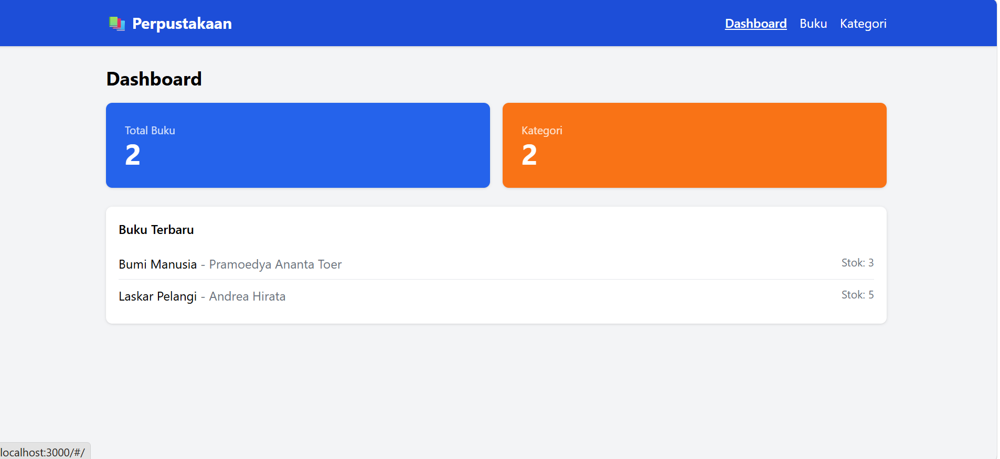
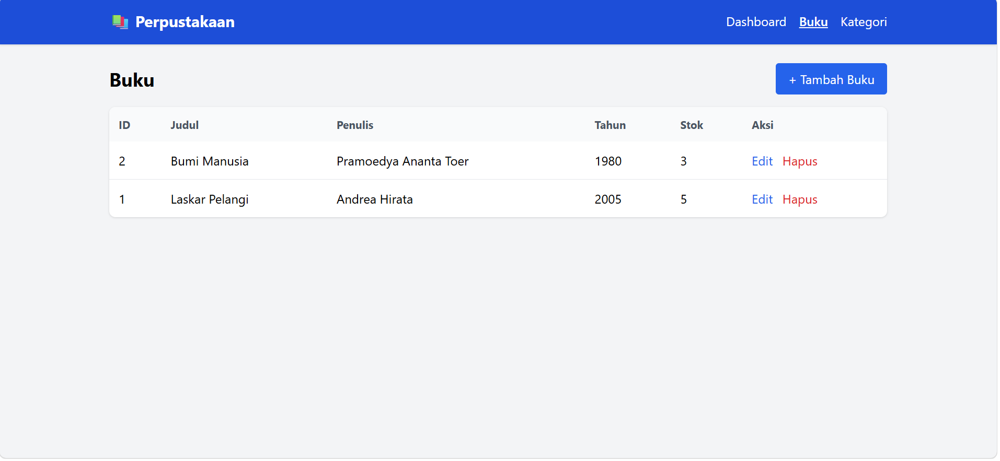
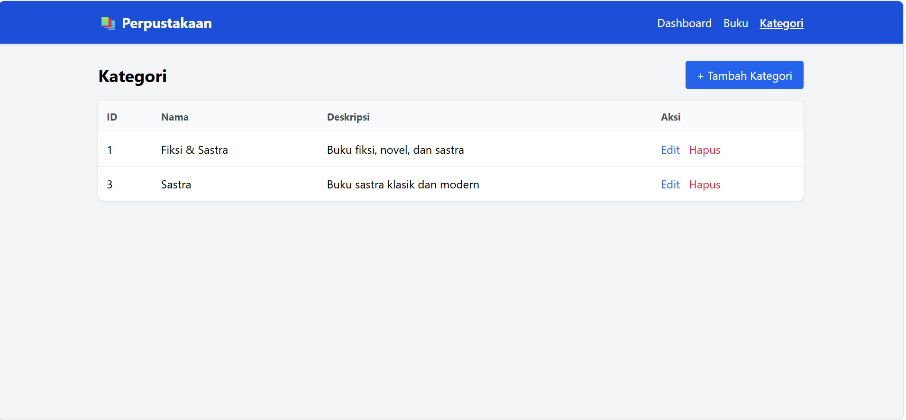

# PBO LKS: Portofolio Praktikum

- Nama : Andini Salsabilla
- NIM  : H1101251066
- Kelas: ____________________
- Mata Kuliah: Pemrograman Berbasis Objek (PBO)
- Dosen Pengampu: Syahru Rahmayuda, M.Kom

## Deskripsi

Aplikasi perpustakaan sederhana: REST API (PHP modern, PSR-4, SOLID, MVC, MySQL)
dengan frontend terpisah (Tailwind CSS).

## Fitur

- CRUD Buku dan CRUD Kategori lewat REST API
- Validasi input dan error handling (404, 422)
- Arsitektur: Repository, Dependency Injection, Front Controller
- Konfigurasi lewat file `.env`
- CORS aktif untuk frontend terpisah
- Frontend: Dashboard, halaman Buku, halaman Kategori

## Struktur Proyek

- `rest-api-perpustakaan/` : backend (API)
- `frontend-perpustakaan/` : frontend
- `pertemuan-01/` ... `pertemuan-07/` : screenshot bukti tiap langkah
- `screenshot-final/` : tampilan aplikasi akhir

## Cara Menjalankan

Prasyarat: PHP 8+, Composer, MySQL.

**Backend**

    cd rest-api-perpustakaan
    composer install
    copy .env.example .env
    mysql -u root -p < database/schema.sql
    php -S localhost:8000 -t public

**Frontend** (terminal lain)

    cd frontend-perpustakaan
    php -S localhost:3000

Buka http://localhost:3000

## Daftar Pertemuan

- [x] [Pertemuan 1: Setup & Database](pertemuan-01/)
- [x] [Pertemuan 2: Core OOP](pertemuan-02/)
- [x] [Pertemuan 3: Framework & Routing](pertemuan-03/)
- [x] [Pertemuan 4: Testing Backend](pertemuan-04/)
- [x] [Pertemuan 5: CRUD Kategori](pertemuan-05/)
- [x] [Pertemuan 6: Frontend](pertemuan-06/)
- [x] [Pertemuan 7: Integrasi & Finalisasi](pertemuan-07/)

## Screenshot Final

